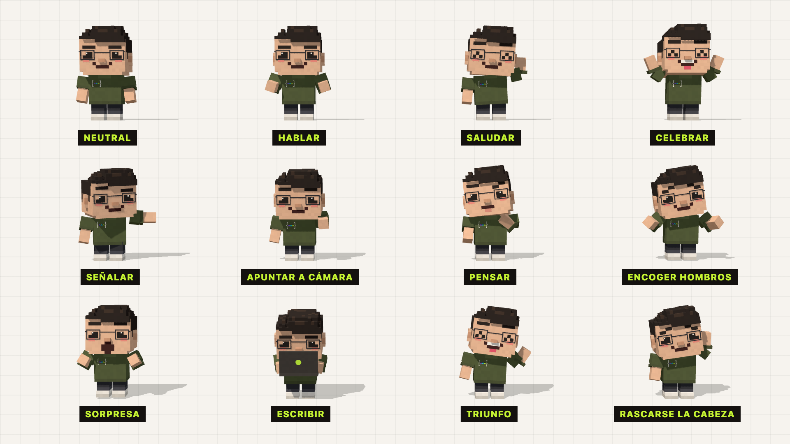

# Avatares

Personajes chibi hechos de **voxels** (cubitos) en 3D real, animados con [Remotion](https://www.remotion.dev/). Cada personaje tiene poses, expresiones, parpadeo, respiración y una **boca que se mueve según un audio de voz**.

El repo trae a **Diego** como ejemplo completo. Para crear un personaje nuevo se copia su código y se cambian los cubitos, los colores y las poses.



## Qué hay en el repo

```
avatares/
├── src/
│   ├── Root.tsx                  # registra las composiciones (aquí agregas las tuyas)
│   ├── PruebaDiegoBambino.tsx       # video de prueba, hoja de poses y hoja de giro
│   ├── diegoBambino/             # TODO el código de Diego (copiar para crear uno nuevo)
│   │   ├── modelo.ts             #   cubitos: cuerpo, pelo, cara, ropa, colores (PAL)
│   │   ├── poses.ts              #   poses, expresiones, animación y sincronía con la voz
│   │   ├── DiegoVoxel.tsx    #   componente 3D que une las piezas
│   │   ├── piezas.ts             #   convierte listas de cubitos en mallas 3D
│   │   └── efectos.tsx           #   laptop, destello al aparecer, etc.
│   └── data/                     # datos generados a partir de la voz (JSON)
├── public/voz_corta.wav          # voz de ejemplo
├── scripts/
│   ├── envolvente.py             # audio → volumen por fotograma (mueve la boca)
│   └── transcribir.py            # audio → palabras con tiempos (poses y subtítulos)
├── personajes/diego/             # ficha, bocetos y video de prueba de Diego
├── .claude/skills, .agents/       # skills de Remotion para Claude Code
├── CLAUDE.md                     # instrucciones para Claude Code en este repo
└── requirements.txt              # dependencias de Python
```

## 1. Instalar lo necesario

Necesitas: **Node.js 20.19+** (o 22.13+ / 24), **ffmpeg**, **Python 3.10+** y **git**.

### macOS

```bash
brew install node ffmpeg python git
```

### Windows / Linux

- Node.js: <https://nodejs.org> (o `nvm`).
- ffmpeg: <https://ffmpeg.org/download.html> (Windows: `winget install ffmpeg`; Ubuntu: `sudo apt install ffmpeg`).
- Python: <https://www.python.org/downloads/>.

### Clonar e instalar

```bash
git clone https://github.com/diego-mcr13/avatares.git
cd avatares

# Dependencias de Node (Remotion, three.js, React)
npm install

# Entorno de Python (solo para procesar audios)
python3 -m venv .venv
source .venv/bin/activate        # Windows: .venv\Scripts\activate
pip install -r requirements.txt
```

La primera vez que renderices, Remotion descarga un Chrome headless (unos 100 MB). Es normal que tarde. Si el primer render falla por un *timeout* mientras lo descarga, vuelve a ejecutarlo.

### Comprobar que todo funciona

```bash
npx remotion still DiegoPoses out/poses.png --gl=angle
```

Debe crear `out/poses.png` con las 12 poses de Diego. (`out/` no se sube a git.)

## 2. Ver a Diego en el Studio

```bash
npm run dev
```

Se abre Remotion Studio en el navegador. En la barra lateral están las composiciones:

| Composición | Qué es |
|---|---|
| `PruebaDiego` | Video vertical de 17 s: entra caminando, cambia de pose según la voz, la boca sigue el audio y sale caminando |
| `DiegoPoses` | Imagen con las 12 poses principales |
| `DiegoGiro` | Frente, tres cuartos, perfil y espalda |
| `DiegoEstres` | Poses de estrés y cómo queda después de una explosión |

Para exportar:

```bash
npx remotion render PruebaDiego out/prueba.mp4 --gl=angle
npx remotion still DiegoGiro out/giro.png --gl=angle
```

`--gl=angle` hace que el 3D se renderice bien en Chrome headless.

## 3. Cómo funciona un personaje

Un personaje son **cubitos**. Unidades: 1 = un voxel (Diego mide ~35 voxels).

1. **`modelo.ts`** define cada pieza como una lista de cubitos `{ x, y, z, c }` (posición y color): cabeza, pelo, torso, brazo, antebrazo, pierna, ojos, cejas, boca. Los colores están en el objeto `PAL`.
2. **`DiegoVoxel.tsx`** arma el esqueleto: torso, cabeza, dos brazos (brazo + antebrazo) y dos piernas, y los mueve según un `Estado`.
3. **`poses.ts`** contiene `POSES`: cada pose es un conjunto de rotaciones `[x, y, z]` en radianes para cada articulación, más una expresión (ojos, cejas, boca).
4. **`estadoEn(...)`** calcula el estado en un fotograma: mezcla la pose anterior con la siguiente con un resorte (con anticipación y retraso entre torso, brazo y antebrazo), y añade solo parpadeo, respiración, cambio de peso y cejas que suben cuando la voz sube de golpe.
5. La **boca** abre más o menos según el volumen de la voz en ese fotograma.

Izquierda y derecha siempre son las de la **pantalla**, no las del personaje.

## 4. Crear un personaje nuevo

Ejemplo para un personaje llamado `lucia`.

### 4.1 Copia la base

```bash
cp -R src/diegoBambino src/lucia
cp personajes/diego/ficha.md personajes/lucia/ficha.md   # antes: mkdir -p personajes/lucia
```

En `src/lucia/` renombra `DiegoVoxel.tsx` a `LuciaVoxel.tsx` (y el componente exportado) para no chocar con Diego. Puedes dejar `poses.ts` y `piezas.ts` tal cual si el cuerpo tiene la misma estructura (cabeza, torso, 2 brazos, 2 piernas).

### 4.2 Cambia el aspecto en `modelo.ts`

- **Colores**: edita `PAL` (piel, pelo, ropa, ojos, mejillas…). Es el cambio más rápido para ver un personaje distinto.
- **Pelo**: función `pelo()`. Es una lista de cubitos; cambia el peinado, el largo o el color.
- **Ropa**: `torso()`, `pierna()`, `brazo()`. El logo de la polera es `logoPolera()`; quítalo o cámbialo por tu símbolo.
- **Cara**: ojos (`OJOS`), cejas (`CEJAS`) y bocas (`BOCAS`) son dibujos en texto donde `X` es un cubito y `.` es vacío:

  ```ts
  const OJOS = {
    normal: [".XX", "XXX"],
    feliz:  [".X.", "X.X"],
  };
  ```

- Mira el resultado en cada cambio con el Studio (`npm run dev`) o con `DiegoPoses` y `DiegoGiro`.

Truco: pídele a Claude Code que lo haga a partir de fotos de referencia (ver sección 7).

### 4.3 Registra una composición

En `src/Root.tsx` agrega una composición para tu personaje. Lo más fácil: copia `src/PruebaDiegoBambino.tsx` como `src/PruebaLucia.tsx`, cambia el import de `DiegoVoxel` por tu componente, cambia el `id` de cada `<Composition>` (ids únicos) y agrégala:

```tsx
import { PruebaDiegoBambinoComposition } from "./PruebaDiegoBambino";
import { PruebaLuciaComposition } from "./PruebaLucia";

export const RemotionRoot: React.FC = () => (
  <>
    <PruebaDiegoBambinoComposition />
    <PruebaLuciaComposition />
  </>
);
```

### 4.4 Ficha y bocetos

Guarda en `personajes/lucia/` una `ficha.md` (aspecto, colores, poses, dónde está el código; la de Diego es el modelo), la hoja de poses y el video de prueba:

```bash
npx remotion still PruebaLuciaPoses personajes/lucia/boceto-poses.png --gl=angle
npx remotion render PruebaLucia personajes/lucia/prueba-animacion.mp4 --gl=angle
```

## 5. Darle voz con audios

La boca se mueve con el **volumen** del audio, y las poses se alinean con **lo que dice** (palabras con su tiempo). Para ello hay dos scripts. Activa antes el entorno: `source .venv/bin/activate`.

### 5.1 Consigue un audio

Graba tu voz (cualquier app, formato `.wav`, `.mp3` o `.m4a`) o genera una de prueba. En macOS:

```bash
say -v Paulina -o /tmp/voz.aiff "Hola, soy un personaje nuevo"
ffmpeg -i /tmp/voz.aiff public/lucia_voz.wav
```

Deja los audios en `public/`. Una sola voz por archivo; si hablan dos personajes, usa una pista por personaje (con silencio cuando habla el otro) para que cada uno mueva solo su boca.

### 5.2 Volumen por fotograma (mueve la boca)

```bash
python scripts/envolvente.py public/lucia_voz.wav src/data/lucia_envolvente.json 30
```

Genera una lista de valores entre 0 y 1, uno por fotograma (30 fps). Se conecta en la composición:

```tsx
import envolventeJson from "./data/lucia_envolvente.json";
const ENVOLVENTE = envolventeJson as number[];
const volumen = (frame: number) => ENVOLVENTE[frame] ?? 0;

// dentro del componente:
const estado = estadoEn({ frame, fps: 30, claves: CLAVES, volumen, movimientos: MOVIMIENTOS });
```

Y el audio se reproduce con Remotion:

```tsx
import { Audio, staticFile } from "remotion";
<Audio src={staticFile("lucia_voz.wav")} />
```

### 5.3 Palabras con su tiempo (poses y subtítulos)

```bash
python scripts/transcribir.py public/lucia_voz.wav src/data/lucia_palabras.json small
```

Usa [faster-whisper](https://github.com/SYSTRAN/faster-whisper) y crea un JSON con cada palabra y sus segundos de inicio y fin. La primera vez descarga el modelo (`small` ≈ 500 MB; `tiny` o `base` son más rápidos y menos precisos). Con esos tiempos decides en qué momento cambia la pose (sección 6) y puedes pintar subtítulos; `PruebaDiegoBambino.tsx` tiene un ejemplo (`Subtitulo`).

Para que Whisper escriba bien nombres propios, agrégalos a `INITIAL_PROMPT` en `scripts/transcribir.py`.

### 5.4 Recortar silencios (opcional)

Si grabas con pausas largas, recorta el audio antes de calcular la envolvente y la transcripción, para que todo quede sincronizado:

```bash
ffmpeg -i entrada.wav -af "silenceremove=stop_periods=-1:stop_duration=0.6:stop_threshold=-40dB" public/lucia_voz.wav
```

## 6. Poses, expresiones y movimientos

### 6.1 Cambiar de pose a lo largo del video

En la composición se define una lista de **claves**: en qué segundo empieza cada pose.

```tsx
const CLAVES: Clave[] = [
  { t: 0,   pose: "neutral" },
  { t: 1.25, pose: "saludar" },   // "hola..."
  { t: 3.45, pose: "senalar" },
  { t: 6.0,  pose: "pensar" },
];
```

Los tiempos salen del JSON de palabras (sección 5.3). `estadoEn` hace la transición entre poses (con anticipación y rebote) y añade los gestos automáticos. Poses disponibles (`PoseNombre`):

`neutral`, `hablar`, `saludar`, `celebrar`, `triunfo`, `senalar`, `apuntar`, `pensar`, `encoger`, `sorpresa`, `escribir` (aparece la laptop), `rascar`, `desesperar`, `facepalm`, `ansioso`.

La tabla con el significado de cada una está en `personajes/diego/ficha.md`.

### 6.2 Agregar una pose nueva

1. Agrega el nombre a `PoseNombre` en `poses.ts`.
2. Agrega su entrada en `POSES`: rotaciones de `torso`, `cabeza`, `brazoIzq`/`antebrazoIzq`, `brazoDer`/`antebrazoDer`, `piernaIzq`/`piernaDer` (radianes) y su `expr`. Parte de `BASE` y sobreescribe solo lo que cambia:

   ```ts
   aplaudir: {
     pose: {
       ...BASE,
       brazoIzq: [-0.5, 0, -0.4], antebrazoIzq: [-1.5, 0, 0.5],
       brazoDer: [-0.5, 0, 0.4],  antebrazoDer: [-1.5, 0, -0.5],
     },
     expr: { ...EXPR_BASE, ojos: "feliz", cejas: ["arriba", "arriba"], feliz: true },
     etiqueta: "Aplaudir",
   },
   ```

3. Guía de ejes: en los brazos, `z` los levanta hacia afuera (negativo a la izquierda de la pantalla, positivo a la derecha); `x` negativo los lleva hacia la cámara; en el antebrazo, `x` negativo dobla el codo hacia adelante.
4. Si quieres verla en la hoja de poses, agrégala al arreglo `HOJA` de `PruebaDiegoBambino.tsx`.

Se afina mirando `DiegoPoses` o el Studio.

### 6.3 Expresiones

Cada pose lleva una `expr` con:

| Campo | Valores |
|---|---|
| `ojos` | `normal`, `feliz`, `cerrados`, `chicos` (pupilas diminutas: ansiedad, cara de póker) |
| `cejas` | `[izq, der]` con `normal`, `arriba`, `enojo`, `triste` |
| `boca` | `"habla"` (sigue la voz) o una boca fija |
| `reposo` | boca cuando no hay voz: `cerrada`, `sonrisa`, `sonrisaAbierta`, `O`, `apretada`… |
| `feliz` | cambia las bocas abiertas por sonrisas abiertas |

Para una **expresión nueva**, agrega su dibujo en `OJOS`, `CEJAS` o `BOCAS` (`modelo.ts`) y su nombre al tipo `OjoVar`, `CejaVar` o `BocaVar`. `DiegoVoxel` crea sola una malla por cada variante.

Gestos automáticos que ya trae: parpadeo, respiración, cambio de peso, cejas arriba cuando la voz sube de golpe. En `DiegoVoxel` hay un modo `explotado` (pelo chamuscado y hollín en la cara) útil para gags.

### 6.4 Entradas y salidas

```tsx
const MOVIMIENTOS: Movimiento[] = [
  { tipo: "entrarCaminando", t: 0,     dur: 1.3,  lado: -1 }, // por la izquierda
  { tipo: "salirCaminando",  t: 15.45, dur: 1.45, lado: 1 },  // por la derecha
];
```

También existen `aparecer` y `desaparecer` (con destello).

## 7. Trabajar con Claude Code

El repo incluye `CLAUDE.md` y las skills de Remotion en `.claude/skills/`, así que al abrir Claude Code en esta carpeta ya sabe cómo está organizado el proyecto:

```bash
npm install -g @anthropic-ai/claude-code   # si no lo tienes
cd avatares
claude
```

Ejemplos de lo que puedes pedirle:

- «Crea un personaje nuevo llamado Lucía a partir de las fotos de `referencias/lucia/`, sigue la estructura de Diego.»
- «Agrega la pose `aplaudir` con los brazos al frente y cara feliz.»
- «Haz la composición de Lucía con este audio y sincroniza las poses con lo que dice.»

Si las skills no aparecen, regenera con `npx skills add remotion-dev/skills`.

## 8. Flujo de trabajo en equipo

- Cada persona crea su personaje en su propia rama (`git checkout -b personaje/lucia`) y abre un Pull Request.
- Un personaje nuevo vive en `src/<nombre>/` y `personajes/<nombre>/`; evita tocar `src/diegoBambino/` (Diego) para no generar conflictos.
- No subas renders pesados: `out/` está ignorado. Los videos/imágenes de prueba que sí valga la pena guardar van en `personajes/<nombre>/`.
- Archivos de audio: solo muestras cortas en `public/`.

## Problemas frecuentes

| Problema | Solución |
|---|---|
| `ffmpeg: command not found` | Instala ffmpeg (sección 1) |
| El primer render falla con *timeout* | Remotion estaba descargando Chrome; vuelve a ejecutar |
| El 3D se ve negro o no aparece al renderizar | Agrega `--gl=angle` |
| Rasgos de la cara que parpadean al girar la cabeza | La cámara debe tener `near: 10` (como en `PruebaDiegoBambino.tsx`), no 0 ni 1 |
| `ModuleNotFoundError: faster_whisper` | Activa el entorno: `source .venv/bin/activate` |
| `npm install` falla por versión de Node | Usa Node 20.19+, 22.13+ o 24 |
